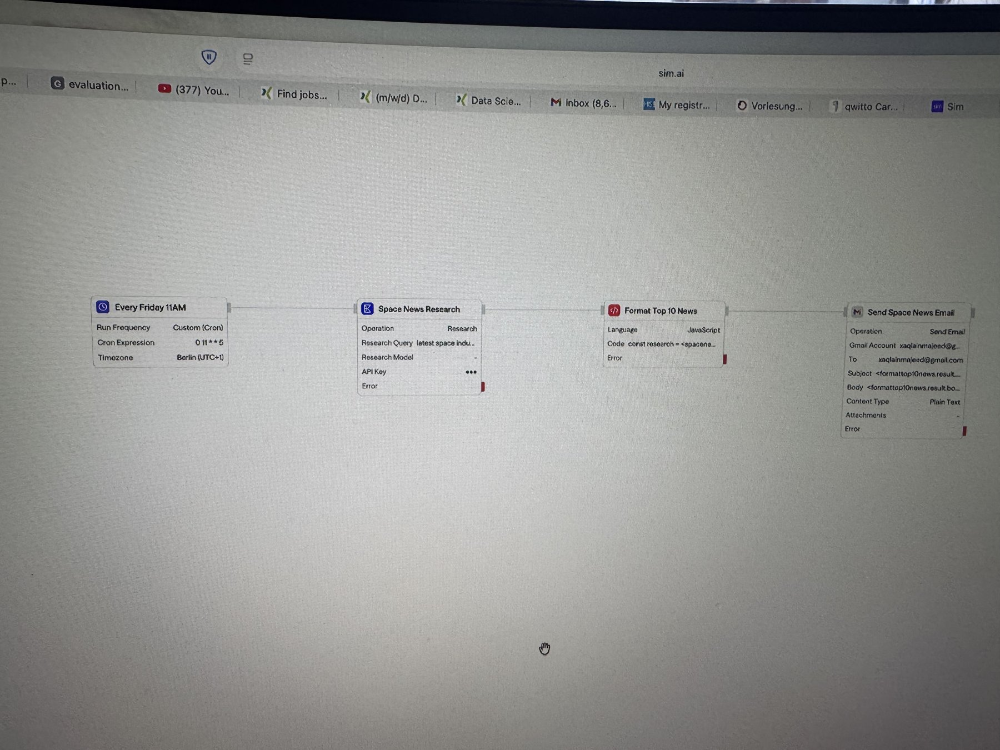
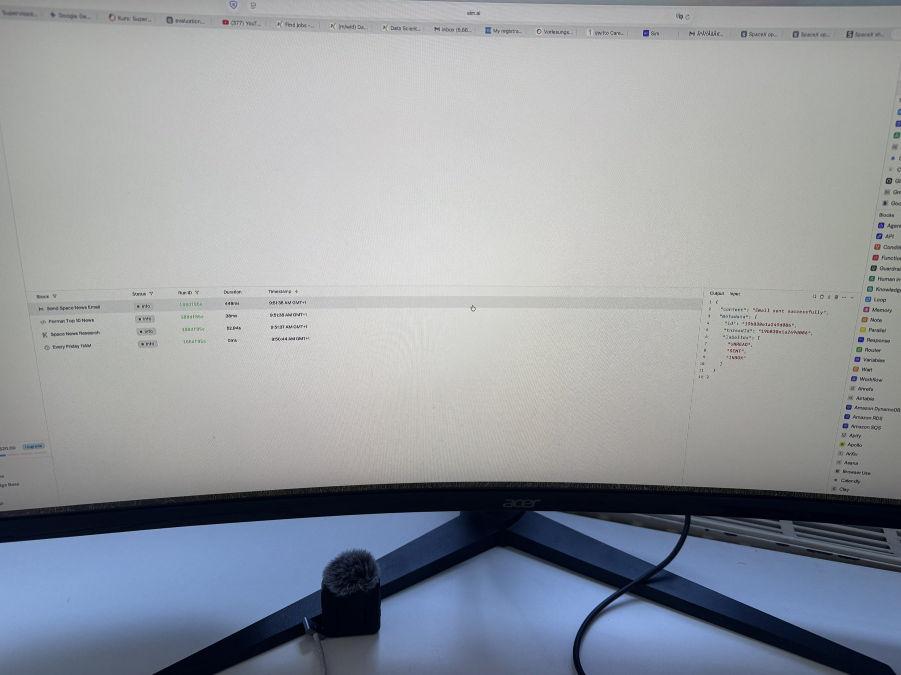

# 🚀 Automated Space Industry News Aggregator
An AI-powered workflow that automatically researches and delivers weekly space industry news digests via email.
## 🎯 What It Does
- Searches the web for the latest space industry developments every Friday
- Covers SpaceX, NASA, ESA, Rocket Lab, Blue Origin, and more
- Compiles top 10 news stories with detailed summaries and source links
- Sends a formatted email digest automatically
## 🛠️ Tech Stack
- **Platform:** Sim Studio
- **AI Research:** Exa AI API
- **Email Delivery:** Gmail API (OAuth)
- **Scheduling:** Cron-based triggers
- **Processing:** JavaScript
## 📸 Screenshots
### Workflow Canvas

### Sample Email Output

## 🔧 How It Works
1. **Schedule Trigger** - Fires every Friday at 11:00 AM (Berlin time)
2. **Exa Research** - AI searches for latest space industry news
3. **Data Formatting** - JavaScript processes and formats top 10 stories
4. **Email Delivery** - Gmail API sends the digest to recipient

## 📊 API Endpoint

